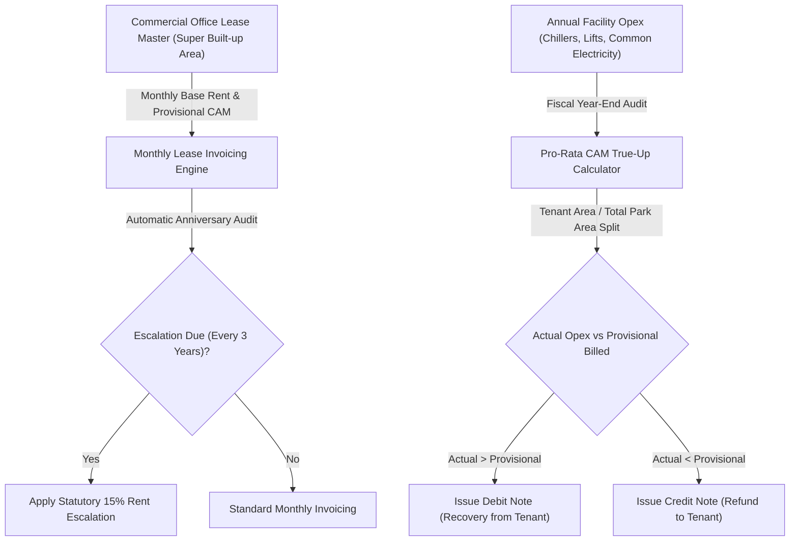

# Frappe REIT Commercial Lease Escalation & Pro-Rata CAM Audit Engine

[](https://frappeframework.com/)
[]()
[]()
[]()
[](LICENSE)

## 📌 Executive Overview & Real-World Client Problem

Institutional commercial real estate landlords and **Real Estate Investment Trusts (REITs)** managing millions of square feet of Grade-A office parks face major revenue leakages:
1. **Missed Rent Escalations:** Multi-year commercial leases specify rigid escalation clauses (typically 15% every 3 years); failure to track anniversary dates leads to uncollected arrears.
2. **Common Area Maintenance (CAM) True-Up Disputes:** Tenants pay provisional monthly CAM rates (e.g. ₹15/sqft). At fiscal year-end, landlords must audit actual operational expenditures (HVAC chillers, security, power backup) and issue precise pro-rata **Debit/Credit Notes (True-Up)**.
3. **Square Footage Apportionment Discrepancies:** Tenants dispute utility allocations if usable carpet area vs super-built-up area ratios are not transparently audited.

This Frappe application automates commercial lease lifecycles, provisional billing, and annual CAM true-up accounting.

---

## 🏛️ System Architecture Flow



---

## 🚀 Key Engineering Capabilities

- **Automatic Lease Escalation Scheduler:** Enforces contractual anniversary rent adjustments without manual intervention.
- **Pro-Rata Super Built-up Area Allocator:** Splits common campus facility expenses transparently based on square footage.
- **Year-End CAM True-Up Reconciliation:** Generates auditable debit/credit vouchers reconciling provisional vs actual operational costs.
- **Tenant Lock-In & Security Deposit Guard:** Tracks lock-in periods, fit-out rent-free periods, and deposit amortization.

---

## 📂 Frappe DocType Schema & Data Structure

```text
reit_commercial_cam/
├── reit_commercial_cam_core/
│   ├── doctype/
│   │   ├── commercial_tenant_lease/
│   │   │   ├── commercial_tenant_lease.json
│   │   │   ├── commercial_tenant_lease.py
│   │   │   └── commercial_tenant_lease.js
│   │   └── cam_true_up_settlement/
│   │       └── cam_true_up_settlement.json
│   └── workspace/
│       └── reit_commercial_cam_workspace/
│           └── reit_commercial_cam_workspace.json
```

---

## ⚡ Frappe Hooks & Whitelisted APIs

- **REST Endpoint:** `POST /api/method/reit_commercial_cam.api.compute_monthly_invoice`
- **Whitelisted Method:** `@frappe.whitelist() def execute_annual_cam_true_up(lease_id, actual_annual_cam_opex_total)`
- **Hooks Event:** `scheduler_events.monthly` runs automated rent generation and escalation checks.

---

## 🛠️ Installation & Bench Setup

```bash
bench get-app https://github.com/shyampandey1104/frappe-reit-commercial-tenant-escalation-cam
bench --site erp.yourdomain.com install-app reit_commercial_cam
bench --site erp.yourdomain.com migrate
python3 -m unittest discover tests
```

---

## 📄 License
MIT License. Built for REIT Asset Managers, Tech Park Developers, and Commercial Property Leasing Desks.
